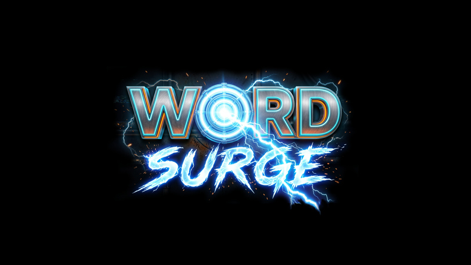

  

# Greathouse Games — bug reports

This repo is just a place to report bugs and problems with Greathouse Games titles. **There is no
source code here** — the games themselves are closed-source. This is only for tracking issues.

## Titles this covers

<table>
  <tr>
    <td align="center">
       
      <a href="https://greathousegames.com/games/GroupTherapy">GroupTherapy</a>
    </td>
    <td align="center">
       
      <a href="https://greathousegames.com/games/JollyRogerBones">Jolly Roger Bones</a>
    </td>
    <td align="center">
       
      <a href="https://greathousegames.com/games/WordSurge">Word Surge</a>
    </td>
  </tr>
  <tr>
    <td align="center">
       
      <a href="https://greathousegames.com/games/WordSearch">WordSearch</a>
    </td>
    <td align="center">
       
      <a href="https://greathousegames.com/games/SuDo9">Sudo9</a>
    </td>
    <td align="center">
       
      <a href="https://greathousegames.com/games/YachtAtSea">Yacht at Sea</a>
    </td>
  </tr>
</table>

And anything else sold at [greathousegames.com](https://greathousegames.com).

## Reporting a bug

1. [Search existing issues](../../issues) first — someone may have already reported it.
2. [Open a new issue](../../issues/new/choose) and include:
   - Which game, and its version (shown on the game's page or in its "About" screen)
   - Your OS (Windows or Linux) and version
   - What you expected to happen, and what actually happened
   - Steps to reproduce it, if you can

## Not a bug?

- **Installation help** (e.g. a SmartScreen warning) — check the [FAQ](https://greathousegames.com/faq) first.
- **Lost serial number, expired download link, refund or purchase questions** — email
  [support@greathousegames.com](mailto:support@greathousegames.com) directly; those involve your
  order details, which don't belong in a public issue.
- **Just want to say something nice, or ask a general question** — the email above works for that
  too.

---

<picture><source media="(prefers-color-scheme: dark)" srcset="images/rochaus-design-dark.png"></picture>

**Rochaus Design, LLC d/b/a Greathouse Games** [greathousegames.com](https://greathousegames.com)

Copyright (c) 2026 Rochaus Design, LLC d/b/a Greathouse Games. All rights reserved.

